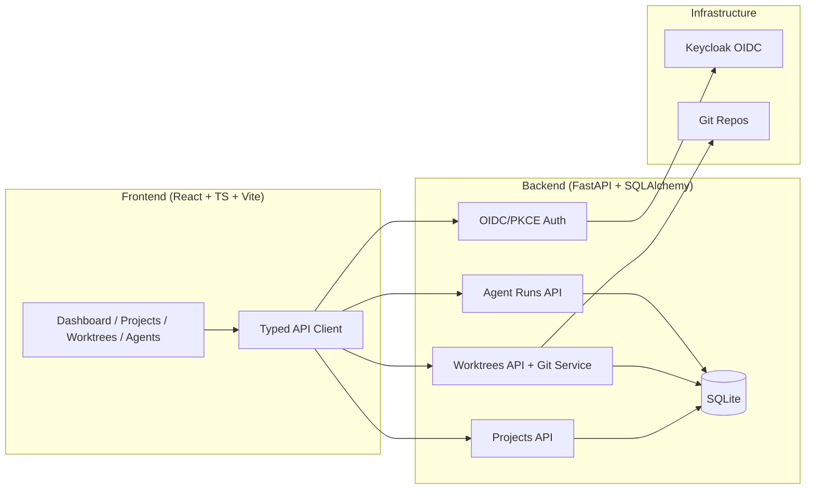

# Vector Hub — Ryan Vo | AI & Machine Learning

Current version: `1.0.0`.

**Vector Hub | Ryan Vo | AI & Machine Learning**

Vector Hub is a web-based AI infrastructure platform for orchestrating fleets of coding agents (Claude Code, Codex, OpenCode, and any CLI agent) across isolated git worktrees. It enables developers to fan prompts across multiple agents in parallel, track usage and costs, and manage agent lifecycles from a unified dashboard.

## Problem

Modern AI-assisted development involves running multiple coding agents (Claude Code, Codex, OpenCode, etc.) on different tasks simultaneously. Managing these agents across projects is fragmented — developers juggle multiple terminals, manually create git worktrees, and have no centralized view of agent status, usage, or costs. There's no standard way to track API usage across providers or estimate costs.

## Solution

Vector Hub provides a cohesive platform with three core workflows:

1. **Project & Worktree Management** — Register git repositories, create isolated worktrees from any branch/ref, and track their status through creation/ready/error/archived lifecycle.

2. **Agent Orchestration** — Launch coding agents (Claude Code, Codex, OpenCode, custom) in worktrees, track their runs (pending/running/completed/failed/stopped), and view logs/metrics.

3. **Usage Tracking & Cost Estimation** — Parse agent usage from local state/logs, display per-provider usage with reset windows, estimate costs using a local price table, and support multi-account switching.

## Architecture



## Quick Start

### Prerequisites

- Docker and Docker Compose
- Node.js 24+ (for local frontend development)
- Python 3.12+ (for local backend development)

### With Docker Compose (Recommended)

```bash
# Clone the repository
git clone https://github.com/A220man/vector-hub-ryan-vo.git
cd vector-hub-ryan-vo

# Copy environment template and configure
cp .env.example .env
# Edit .env with your secrets (OIDC_CLIENT_SECRET, SECRET_KEY, etc.)

# Start all services
docker compose up -d

# Services:
# - Frontend: http://localhost:5173
# - Backend API: http://localhost:8000
# - Keycloak: http://localhost:8080 (admin/admin)
```

### Local Development

**Backend:**
```bash
cd backend
python -m venv .venv
.venv/bin/pip install -r requirements.txt
DEMO_MODE=true .venv/bin/uvicorn app.main:app --reload --host 127.0.0.1 --port 8000
```

**Frontend:**
```bash
cd frontend
npm install
npm run dev
# Runs on http://localhost:5173 with API proxy to backend
```

### Running Tests

**Backend:**
```bash
cd backend
.venv/bin/python -m pytest -v
```

**Frontend:**
```bash
cd frontend
npm test
npm run build  # Includes type check
```

## Configuration

Key environment variables (see `.env.example`):

| Variable | Description | Required |
|----------|-------------|----------|
| `DATABASE_URL` | SQLite or PostgreSQL URL | Yes |
| `OIDC_ISSUER` | Keycloak realm URL | Yes (prod) |
| `OIDC_CLIENT_ID` | OIDC client ID | Yes (prod) |
| `OIDC_CLIENT_SECRET` | OIDC client secret | Yes (prod) |
| `OIDC_REDIRECT_URI` | Frontend callback URL | Yes (prod) |
| `OIDC_AUDIENCE` | API audience for token validation | Yes (prod) |
| `DEMO_MODE` | Enable demo auth (localhost only) | No (default: false) |
| `LLM_API_KEY` | LLM provider API key | No (opt-in) |
| `LLM_PROVIDER` | LLM provider (openai, anthropic, gemini, ollama) | No |
| `SECRET_KEY` | Session signing key | Yes (prod) |
| `COOKIE_SECURE` | Set Secure flag on cookies (true for HTTPS) | No (default: false) |
| `GIT_WORKTREE_BASE` | Base directory for worktrees | No (default: /tmp/vectorhub-worktrees) |
## Keycloak Setup

The compose.yaml includes Keycloak with a pre-configured realm (`vectorhub`) containing:

- Client: `vector-hub` (confidential, PKCE enabled)
- Roles: `viewer`, `operator`, `admin`
- Default user: `admin` / `admin` (realm admin)

### SAML Identity Brokering

Keycloak supports upstream SAML IdPs through identity brokering:

1. In Keycloak Admin Console → Identity Providers → Add SAML v2.0
2. Configure your SAML IdP metadata/endpoints
3. Map SAML attributes to Keycloak attributes (email, username)
4. Add the identity provider to the `vector-hub` client's authentication flow

## API Reference

All endpoints require authentication (Bearer token or session cookie).

### Projects
| Method | Endpoint | Description |
|--------|----------|-------------|
| GET | `/api/v1/projects` | List projects (pagination, filter by status, search) |
| POST | `/api/v1/projects` | Create project (operator+) |
| POST | `/api/v1/projects/{id}/clone` | Clone git repo, mark ready (operator+) |
| GET | `/api/v1/projects/{id}` | Get project |
| PATCH | `/api/v1/projects/{id}` | Update project (operator+) |
| DELETE | `/api/v1/projects/{id}` | Archive project (admin) |

### Worktrees
| Method | Endpoint | Description |
|--------|----------|-------------|
| GET | `/api/v1/worktrees` | List worktrees (filter by project, status) |
| POST | `/api/v1/worktrees/{project_id}` | Create worktree (operator+) |
| GET | `/api/v1/worktrees/{id}` | Get worktree |
| DELETE | `/api/v1/worktrees/{id}` | Remove worktree (admin) |
| GET | `/api/v1/worktrees/{id}/diff` | Get diff against start ref |

### Agent Runs
| Method | Endpoint | Description |
|--------|----------|-------------|
| GET | `/api/v1/agent-runs` | List agent runs (filter by worktree, agent, status) |
| POST | `/api/v1/agent-runs?worktree_id={id}` | Create agent run (operator+) |
| GET | `/api/v1/agent-runs/{id}` | Get agent run |
| PATCH | `/api/v1/agent-runs/{id}` | Update agent run (operator+) |
| POST | `/api/v1/agent-runs/{id}/start` | Start run (operator+) |
| POST | `/api/v1/agent-runs/{id}/stop` | Stop run (operator+) |
| POST | `/api/v1/agent-runs/{id}/complete` | Complete run (operator+) |
| GET | `/api/v1/agent-runs/{id}/logs` | Get run logs/metrics |

### Auth
| Method | Endpoint | Description |
|--------|----------|-------------|
| GET | `/api/v1/auth/login` | Initiate OIDC login with PKCE |
| GET | `/api/v1/auth/callback` | Handle OIDC callback |
| POST | `/api/v1/auth/demo-login` | Demo login (DEMO_MODE only) |
| POST | `/api/v1/auth/logout` | Logout |
| GET | `/api/v1/auth/me` | Get current user |
| GET | `/api/v1/auth/csrf` | Get CSRF token |

## Security

- **OIDC Authorization Code + PKCE** — Secure SPA authentication via Keycloak
- **Role-based Access Control** — `viewer`, `operator`, `admin` roles on all data endpoints
- **CSRF Protection** — Double-submit cookie pattern for cookie-authenticated writes
- **HttpOnly Cookies** — Session cookies are HttpOnly, Secure (in prod), SameSite=Lax
- **No Token Persistence** — Access/refresh tokens never stored in localStorage
- **Demo Mode Guard** — Refuses to start in production with `DEMO_MODE=true`
- **Redacted Errors** — LLM provider errors never leak credentials

### Security Limitations

- SQLite is used for development; production should use PostgreSQL with connection pooling
- In-memory session/PKCE stores don't scale; use Redis for production
- No rate limiting implemented on API endpoints
- Keycloak runs in dev mode with self-signed certs; use TLS termination in production

## Deployment

### Production Requirements

1. **Reverse Proxy** — Terminate TLS with nginx/Traefik/Caddy
2. **PostgreSQL** — Replace SQLite with managed PostgreSQL
3. **Redis** — Replace in-memory session/PKCE stores
4. **Keycloak** — External managed Keycloak or hardened self-hosted
5. **Secrets** — Use Docker secrets or secret manager (Vault, AWS Secrets Manager)
6. **Backup/Restore** — Regular PostgreSQL backups; worktree directories are ephemeral

### TLS Reverse Proxy (nginx example)

```nginx
server {
    listen 443 ssl http2;
    server_name vectorhub.example.com;

    ssl_certificate /etc/letsencrypt/live/vectorhub.example.com/fullchain.pem;
    ssl_certificate_key /etc/letsencrypt/live/vectorhub.example.com/privkey.pem;

    location / {
        proxy_pass http://frontend:80;
        proxy_set_header Host $host;
        proxy_set_header X-Real-IP $remote_addr;
        proxy_set_header X-Forwarded-For $proxy_add_x_forwarded_for;
        proxy_set_header X-Forwarded-Proto $scheme;
    }

    location /api/ {
        proxy_pass http://backend:8000;
        proxy_set_header Host $host;
        proxy_set_header X-Real-IP $remote_addr;
        proxy_set_header X-Forwarded-For $proxy_add_x_forwarded_for;
        proxy_set_header X-Forwarded-Proto $scheme;
    }

    location /auth/ {
        proxy_pass http://backend:8000;
        proxy_set_header Host $host;
        proxy_set_header X-Real-IP $remote_addr;
        proxy_set_header X-Forwarded-For $proxy_add_x_forwarded_for;
        proxy_set_header X-Forwarded-Proto $scheme;
    }
}
```

## AI/ML Evaluation

This initial release evaluates the deterministic project and agent-run management foundation. It does not establish model quality, coding-agent throughput, or production latency. Git worktree execution, process supervision, and usage aggregation must be judged against their respective entries in `feature-plan.json`; a stored run status is not evidence that an agent process executed.

### Reproduce the checks

From the repository root, install dependencies and run the existing API and browser-component regression suites:

```bash
python3 -m venv backend/.venv
backend/.venv/bin/pip install -r backend/requirements.txt
(cd backend && .venv/bin/python -m pytest -v)
(cd frontend && npm ci && npm test && npm run build)
docker compose config --quiet
```

The backend suites exercise project/worktree/run records, access control, browser-bound OIDC state, nonce and issuer checks, and CSRF enforcement. Frontend suites check the login flow and authenticated mutation client. Inspect command exit codes and individual assertions; the test count can change as features are added. These tests use controlled fixtures and do not prove that a real coding agent or deployed identity provider completed a session.

### Deployment acceptance

A complete deployment check must build and start the Compose stack, authenticate through the actual Keycloak browser flow, create and retrieve a project through the frontend, verify rejected unauthenticated/CSRF-invalid writes, and verify data survives a backend restart after signing in again. Unit mocks and Compose schema validation do not substitute for this check. See the hosted CI results for the exact revision; pending or failed checks are not a passing result.

### Results and limits

No measured latency, worktree-throughput, or model-quality baseline is published yet. Record the source commit, hardware, workload, elapsed time and raw results before adding numerical performance claims. In-memory login sessions do not survive backend restarts; production deployments require persistent shared session storage. This evaluation makes no claims about external LLM accuracy or agent task completion.

## Contributing

Contributions are welcome — file an issue or submit a pull request on GitHub.

**Ryan Vo <ryandtvo@gmail.com>** | AI & Machine Learning

## License